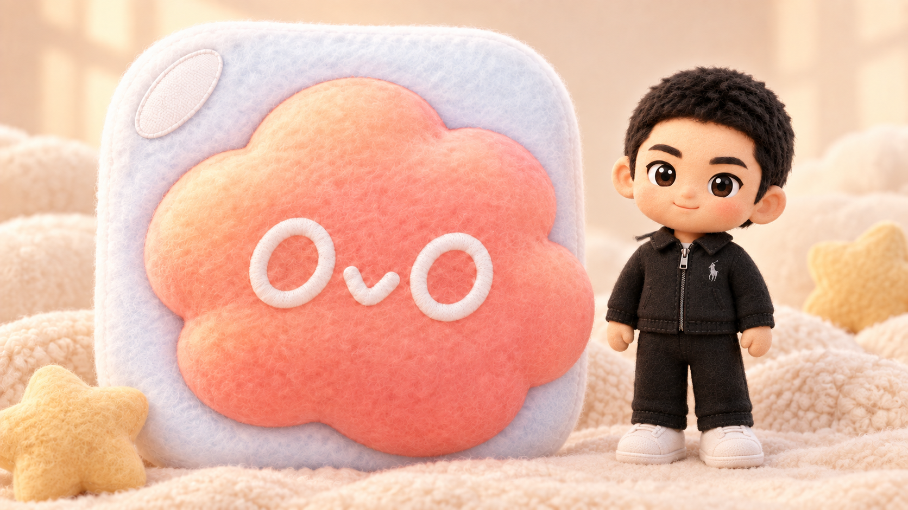
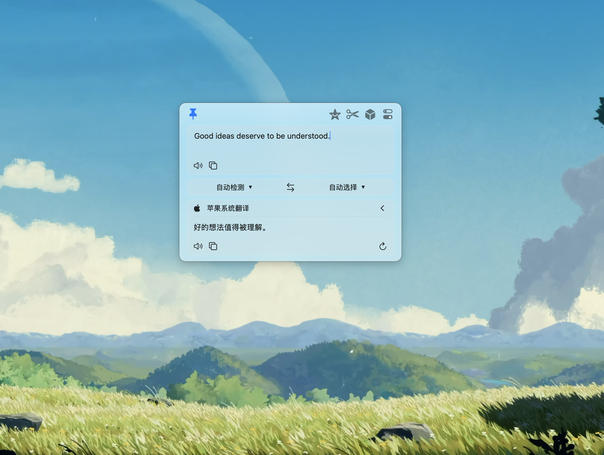
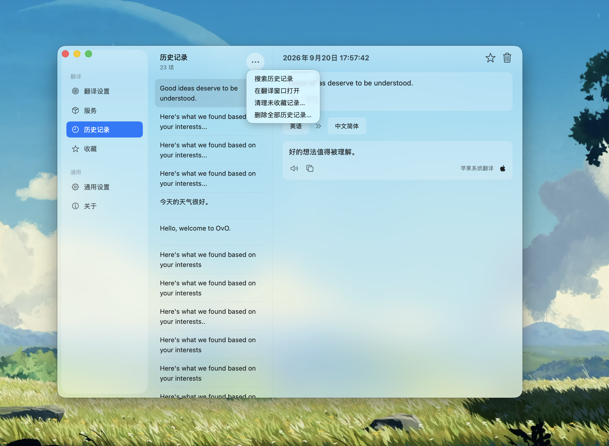
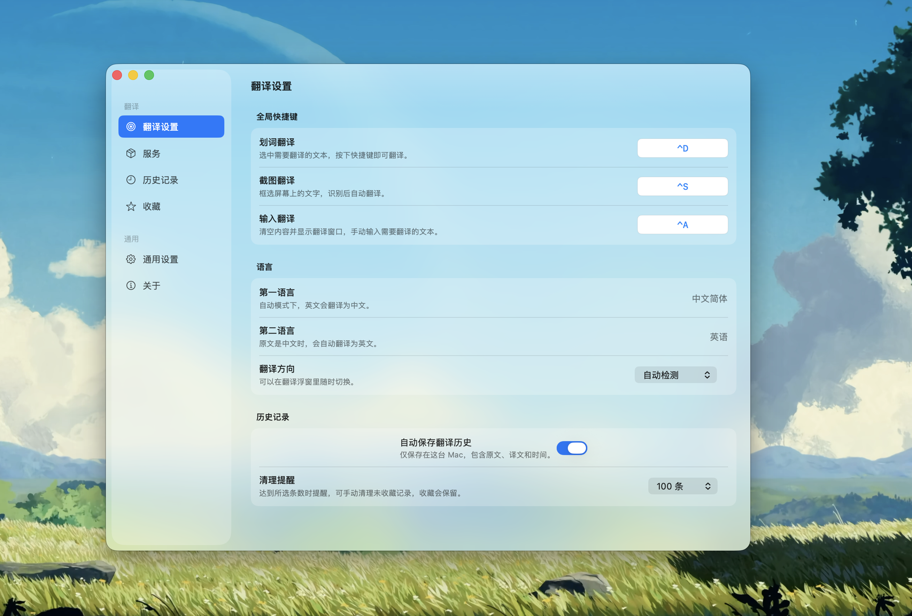
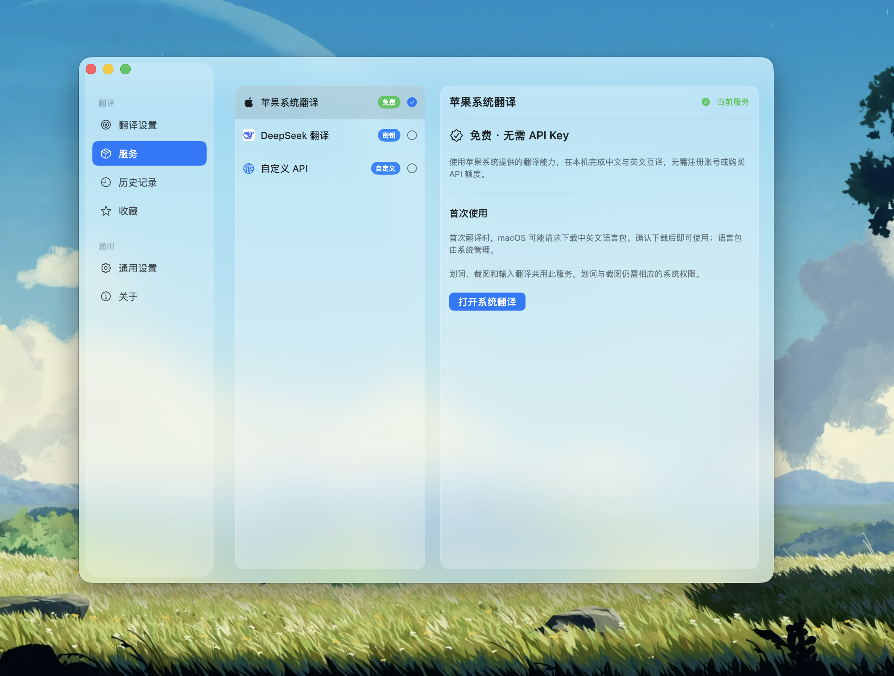

# OvO

**OvO 复刻了 Bob 的三个核心功能：划词翻译、截图翻译、输入翻译，且完全免费。**

一款原生 macOS 中英文翻译工具。柔焦玻璃浮窗融入你的桌面壁纸，让好的想法，随时被理解。

内置免费的苹果系统翻译，也支持 DeepSeek 和自定义模型 API。**应用本身免费；使用第三方 API 时，费用由对应服务商决定。**

[下载 OvO](https://github.com/17lijunyi/OvO/releases/latest) · [反馈问题](https://github.com/17lijunyi/OvO/issues) · [作者](https://github.com/17lijunyi) · [MIT License](LICENSE)

## 看看 OvO

### 翻译，就在桌面上

输入、划词、截图，译文都会来到同一个轻巧的浮窗。背景实时模糊，保留壁纸的色彩；点亮钉子可保持置顶。



### 免费的系统翻译，也能连接自己的模型

macOS 15 及以上可使用苹果系统翻译，无需 API Key。也可以切换 DeepSeek，或填写自己的 OpenAI Chat Completions 兼容接口。



### 留下值得再看的句子

历史记录与收藏保存在本机。支持搜索、复制、清理未收藏记录，以及确认后删除全部历史记录。



### 三个快捷键，随手翻译

Control + D 划词、Control + S 截图、Control + A 输入。默认累积到 100 条历史时提醒整理，由你决定是否删除。



## 能做什么

| 功能 | 使用方式 |
| --- | --- |
| 划词翻译 | 在其他应用中选中文字，按 **Control + D** |
| 截图翻译 | 按 **Control + S** 框选区域，本机识别文字后翻译；Esc 取消 |
| 输入翻译 | 按 **Control + A** 打开输入窗口；Enter 翻译，Shift + Enter 换行 |
| 中英文互译 | 自动识别方向，也可手动选择或交换语言 |
| 历史与收藏 | 搜索原文和译文、标星收藏、复制、重新打开、手动清理 |
| 置顶浮窗 | 点击钉子保持置顶；未置顶时切到其他应用自动收起 |

关闭窗口后，OvO 继续在后台运行；点击 Dock 图标可重新打开。菜单栏不显示常驻小图标。退出使用 **Command + Q**。

## 下载与安装

1. 从 [Releases](https://github.com/17lijunyi/OvO/releases/latest) 下载 `OvO-macOS-arm64.zip`。
2. 解压，将 `OvO.app` 拖入「应用程序」后打开。
3. macOS 15 及以上默认使用苹果系统翻译，首次按系统提示下载中英文语言包即可。
4. 使用划词或截图翻译时，按提示开启相应权限；如果 macOS 要求重新打开应用，请完成后重启。

**系统要求：** macOS 14 或更高版本。当前预编译安装包适用于 Apple Silicon（M 系列）Mac；免费苹果系统翻译需要 macOS 15 或更高版本。macOS 14 可配置 DeepSeek 或自定义 API。Intel Mac 暂未提供已验证的安装包。

当前安装包使用固定的本机开发证书签名，尚未完成 Apple Developer ID 签名与公证。首次打开可能被 macOS 拦截；确认下载来源为本仓库后，可在「系统设置 → 隐私与安全性」中使用「仍要打开」。无需关闭系统安全保护。也可以自行从源码构建。

## 权限与隐私

| 权限或数据 | 用途 |
| --- | --- |
| 辅助功能 | 获取其他应用中选中的文字，用于划词翻译 |
| 屏幕录制 | 获取你框选的屏幕区域，用于截图翻译；不会持续录屏 |
| API Key | 保存在 macOS 钥匙串中，DeepSeek 与自定义 API 分开保存 |
| 翻译历史 | 保存在本机，可关闭新记录保存或手动删除 |

权限由 macOS 管理，需要用户亲自确认；仅使用输入翻译无需上述两项权限。首次读取 API Key 时可能出现钥匙串授权提示。

截图文字使用 Apple Vision 在本机识别。苹果系统翻译在本机处理；使用 DeepSeek 或自定义 API 时，待翻译的文字会发送到你选择的服务地址。历史记录保存在 `~/Library/Application Support/Ovo/history.json`，不做云同步。

若系统开关已打开但应用仍提示未授权，请先退出 OvO，确认运行的是「应用程序」里的版本；必要时移除系统设置中的旧 OvO 条目，重新添加 `/Applications/OvO.app` 并授权。更换构建签名身份可能需要重新授权。

## 翻译服务

| 服务 | 配置 | 费用 |
| --- | --- | --- |
| 苹果系统翻译 | macOS 15+；首次下载中英文语言包 | 免费，无需 API Key |
| DeepSeek | 自行填写 API Key，可调整模型与翻译参数 | 按服务商规则计费 |
| 自定义 API | 服务名称、API 地址、模型 ID、可选 API Key | 由接入的服务决定 |

自定义服务支持 **OpenAI Chat Completions 兼容接口**，可填写基础地址（如 `https://example.com/v1`）或完整 `/chat/completions` 地址。远程服务要求 HTTPS；本机 `localhost`、`127.0.0.1`、`::1` 支持 HTTP。无鉴权的本机服务可不填密钥。兼容性取决于服务的接口实现。

服务页选择配置后，点击「设为当前服务」即可用于三种翻译入口。「测试连接」会发起一次小型真实请求。

## 从源码构建

需要 macOS、支持 Swift Testing 的 Swift 6 工具链，以及包含 Translation.framework 的 macOS 15 或更新 SDK。可使用相应版本的 Xcode 或 Apple Command Line Tools。

```sh
git clone https://github.com/17lijunyi/OvO.git
cd OvO
./scripts/build-app.sh
./scripts/test.sh
```

应用生成在 `dist/OvO.app`。项目使用 SwiftUI、AppKit、Vision 和 Translation，无第三方运行时依赖。

构建脚本会创建并复用本机独立签名身份。详细构建、签名说明及验证范围见 [开发说明](docs/DEVELOPMENT.md)。

## 反馈与贡献

欢迎通过 [Issues](https://github.com/17lijunyi/OvO/issues) 报告问题或提出建议，也欢迎 Pull Request。报告问题时请附上 macOS 版本、芯片类型、OvO 版本、复现步骤和必要截图；请勿提交 API Key 或私人翻译内容。

## 致谢与许可

感谢 Bob 带来的翻译交互灵感。OvO 是独立实现的开源项目，与 Bob 官方无关联。

源码采用 [MIT License](LICENSE)。第三方名称、标志及截图中的壁纸归各自权利人所有；DeepSeek 图标仅用于标识对应服务，不代表背书。封面结合作者的 IP 形象使用 AI 生成，界面图片为作者的真实桌面截图。

由 [17lijunyi](https://github.com/17lijunyi) 制作。
